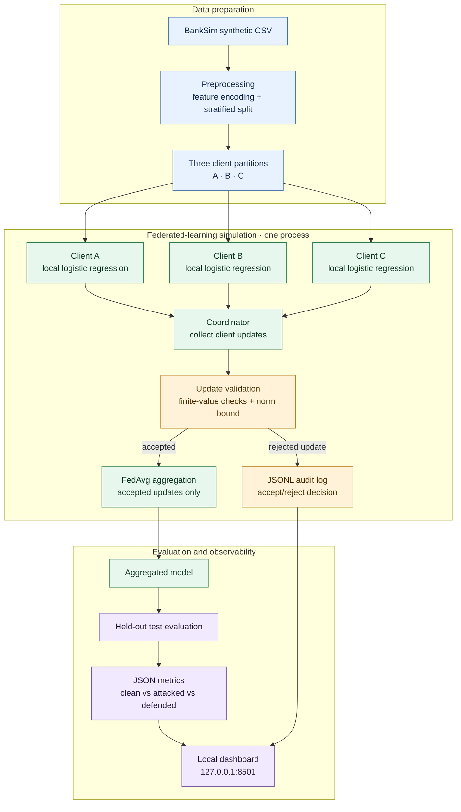
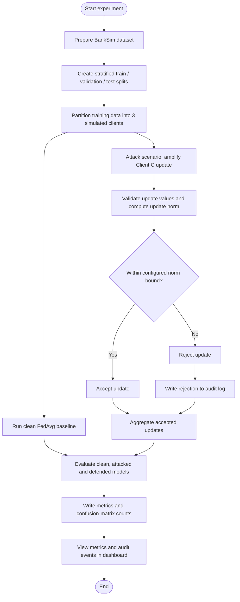
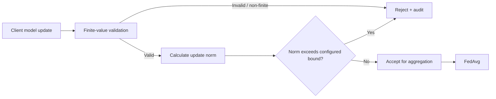

# FederatedShield AI
### Privacy-Preserving Collaborative Fraud Detection — Research Prototype on IBM LinuxONE

FederatedShield AI explores how collaborative fraud-detection models can be made more resilient to a malicious participant sending an abnormal model update. The project uses the **BankSim synthetic payment dataset**, three **simulated clients**, logistic regression, Federated Averaging (FedAvg), a deliberately amplified-update attack, a simple update-norm defense, audit logs, and a local web dashboard.

> **Status:** Research prototype / controlled experiment. The three clients are simulated in one Python process. This is not a production federated-learning deployment and does not currently provide differential privacy, secure aggregation, isolated client execution, or production-grade identity verification.

## Contents

- [Problem](#problem)
- [Approach](#approach)
- [Architecture and workflow](#architecture-and-workflow)
- [Technology stack](#technology-stack)
- [Experiment results](#experiment-results)
- [Run on IBM LinuxONE](#run-on-ibm-linuxone)
- [Dashboard](#dashboard)
- [Repository layout](#repository-layout)
- [Security and privacy notes](#security-and-privacy-notes)
- [Limitations and future work](#limitations-and-future-work)

## Problem

Collaborative machine-learning systems can be affected when one participant submits a corrupted or unusually large model update. In fraud detection, a poisoned shared model may produce more false alerts or change its ability to identify fraudulent transactions. Teams need a way to validate contributions and keep an auditable record of aggregation decisions.

## Approach

1. **Prepare data:** clean and encode BankSim features, exclude direct customer and merchant identifiers, and create stratified train/validation/test splits.
2. **Simulate clients:** divide training data among three clients with matching label ratios. This is a simulation of partitioned data, not separate networked clients.
3. **Train collaboratively:** fit local logistic-regression models and aggregate their updates with FedAvg over five rounds.
4. **Inject a controlled attack:** multiply one simulated client's update by a large factor to create a deliberately amplified update.
5. **Apply a defense:** check update validity and compare update norms with a threshold derived from the median client-update norm; reject updates that exceed the configured bound.
6. **Evaluate:** compare clean, attacked, and defended runs on a held-out test set using precision, recall, F1, accuracy, and confusion-matrix counts.
7. **Audit and visualize:** write JSON/JSONL experiment outputs and display metrics and client decisions in a lightweight local dashboard.

## Architecture and workflow

The diagrams below describe the **current implemented prototype**. The three clients are simulated in one Python process; arrows represent logical data/control flow, not separate network connections.

### 1. System architecture



### 2. Experiment workflow



### 3. Trust and containment decision



**Diagram scope:** this implementation demonstrates a controlled, amplified-update attack and a simple update-norm defense. It does not currently implement separate client machines, differential privacy, secure aggregation, or general-purpose attack detection. Rejection is selective at the update level, not network-level isolation or production containment.

## Technology stack

- **Platform:** IBM LinuxONE environment, Ubuntu on the s390x architecture (as used during the experiment).
- **Language:** Python 3.12.
- **ML/numerical library:** NumPy.
- **Model:** Logistic regression implemented for the experiment.
- **Federated aggregation:** FedAvg simulation.
- **Dataset:** BankSim synthetic payment transactions.
- **Dashboard:** Python standard-library HTTP server and HTML.
- **Artifacts:** JSON metrics, JSONL audit events, and NumPy model files.

The code runs on LinuxONE; this alone does not mean that every IBM Z security feature is enabled or used. No claim is made that Secure Execution, hardware-backed isolation, or differential privacy is implemented.

## Experiment results

The recorded test-set results from the current run are:

| Scenario | Precision | Recall | F1-score | TP | FP | FN | TN |
|---|---:|---:|---:|---:|---:|---:|---:|
| Clean FedAvg | 0.2382 | 0.9296 | 0.3792 | 1004 | 3211 | 76 | 84906 |
| Attacked FedAvg | 0.0927 | 0.9972 | 0.1696 | 1077 | 10547 | 3 | 77570 |
| Defended FedAvg | 0.2334 | 0.9361 | 0.3737 | 1011 | 3320 | 69 | 84797 |

These figures are from one controlled synthetic-data experiment and the configured threshold. The amplified update substantially increased false positives in the attacked run. The norm-based defense brought the F1-score close to the clean baseline in this particular scenario.

**Interpretation caveats:**
- The defense is designed to demonstrate rejection of a deliberately amplified update. It is not evidence of detection against every model-poisoning or adaptive attack.
- Threshold selection and preprocessing affect the metrics. Re-run the scripts to regenerate results for your environment.
- BankSim is synthetic. These numbers do not establish real-world banking performance.
- High accuracy alone is not an adequate fraud-detection metric because the classes are imbalanced; precision, recall, F1, and false-positive counts matter.

Machine-readable outputs are generated under `outputs_public/` when the scripts are run.

## Run on IBM LinuxONE

The following commands assume the project is already present on your LinuxONE machine and you are in the project root.

### 1. Create and activate a virtual environment

```bash
cd ~/federatedshield_phase1
python3 -m venv .venv
source .venv/bin/activate
python -m pip install --upgrade pip
python -m pip install numpy
```

### 2. Place the dataset

Download the BankSim synthetic dataset from its legitimate source and place the CSV at:

```text
data_public/raw/bs140513_032310.csv
```

The raw dataset is intentionally not committed to this repository. Check the dataset's source and license/terms before redistribution.

### 3. Prepare the data

```bash
python3 scripts/banksim/prepare_banksim.py
```

Expected output files include:

- `data_public/processed/train.csv`
- `data_public/processed/validation.csv`
- `data_public/processed/test.csv`
- `data_public/processed/clients/client_a_train.csv`
- `data_public/processed/clients/client_b_train.csv`
- `data_public/processed/clients/client_c_train.csv`
- `data_public/processed/summary.json`
- `data_public/processed/schema.json`

### 4. Run federated training

```bash
python3 scripts/banksim/train_federated.py
```

This runs the configured FedAvg simulation and writes the model and metrics under `outputs_public/`.

### 5. Run the defense experiment

```bash
python3 scripts/banksim/simulate_defense.py
```

This generates the clean/attacked/defended comparison and audit log in `outputs_public/`.

### 6. Start the dashboard

```bash
python3 scripts/banksim/dashboard.py
```

The dashboard binds to `127.0.0.1:8501` on the host. Keep this process running while viewing the dashboard.

### 7. View it securely from your Windows machine

Open a separate **Windows PowerShell** terminal and create an SSH tunnel (replace the key path and host/login if your environment differs):

```powershell
ssh -N -L 8501:127.0.0.1:8501 -o IdentitiesOnly=yes -i "C:\path\to\your-key.pem" linux1@YOUR_LINUXONE_HOST
```

Then open `http://127.0.0.1:8501/` in your browser. Keep the tunnel open. Do not commit or share your private key.

## Dashboard

The dashboard reads the experiment comparison and audit-log files from `outputs_public/`. It presents model metrics, client update decisions, recent audit events, and the research-prototype limitations. If the files are missing, run the training and defense scripts first.

## Repository layout

```text
FederatedShieldAI/
├── README.md
├── .gitignore
├── scripts/
│   └── banksim/
│       ├── prepare_banksim.py
│       ├── train_federated.py
│       ├── simulate_defense.py
│       └── dashboard.py
├── data_public/
│   ├── raw/                 # local dataset; not committed
│   └── processed/           # generated data; usually not committed
└── outputs_public/          # generated results; publish only sanitized summaries
```

The exact local folder may differ. Generated files and scripts should be checked against the actual working tree before committing.

## Security and privacy notes

- Do not commit private SSH keys (`.pem`), passwords, API tokens, environment files, or private host details.
- Do not publish raw transaction data unless its source terms explicitly permit redistribution.
- The dataset is synthetic, but generated artifacts should still be reviewed before publication.
- This implementation does **not** implement differential privacy, secure aggregation, true client isolation, encrypted inter-client transport, or production identity and authorization controls.
- The update-norm check is a simple defense baseline and may reject legitimate outlier updates or miss attacks that stay within the accepted norm.
- Do not expose the dashboard to a public network without appropriate authentication, TLS, and deployment hardening.

## Limitations and future work

- Run clients as separate processes or machines and introduce a real coordinator/client protocol.
- Evaluate additional poisoning strategies, including sign-flipping, stealthy bounded updates, and adaptive attacks.
- Calibrate defenses on validation data and test robustness across random seeds and client data distributions.
- Add secure aggregation and differential privacy with a documented privacy budget.
- Add client authentication, authorization, transport security, and tamper-evident audit storage.
- Add automated tests, pinned dependencies, and reproducible experiment configuration.

## Reproducibility

Record Python and NumPy versions, dataset source/version, random seeds, experiment parameters, and generated output files for each new run. Results above describe the current recorded run and may change if configuration or data changes.

## License

No license has been specified yet. Add a license file only after deciding how you want others to reuse the code.
